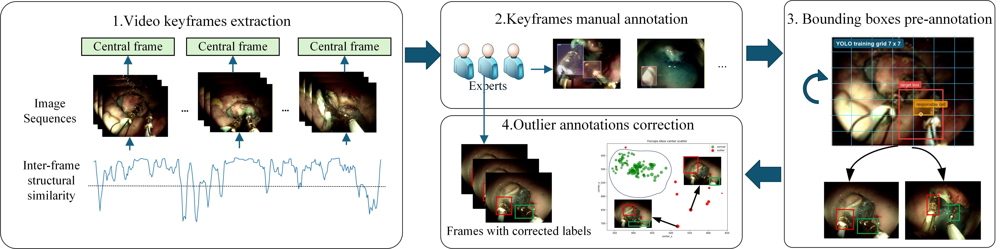

# ESD-MGASet: Multi-Granularity Annotations for Endoscopic Submucosal Dissection

This repository provides multi-granularity annotations for endoscopic submucosal dissection (ESD) scene understanding, based on the Renji ESD and CoPESD datasets.

## Dataset Overview

The annotations cover three levels: **workflow (phase/task)**, **instrument action (action/step)**, and **instrument localization (bounding box)**, supporting the development and evaluation of multi-granularity surgical scene understanding methods.

## Original Datasets

### Renji ESD

Renji ESD provides ESD videos with procedural phase annotations. We manually corrected selected phase labels and extended the original dataset with instrument bounding boxes and fine-grained action annotations.

**Original dataset:** [Renji ESD — Figshare](https://springernature.figshare.com/articles/dataset/Renji_endoscopic_submucosal_dissection_video_data_set_for_early_gastric_cancer/28045295)

### CoPESD

CoPESD provides endoscopic images with instrument bounding boxes and language-based operative descriptions. We refined the instrument annotations and standardized the descriptions into structured task and step labels.

**Original dataset:** [CoPESD — GitHub](https://github.com/gkw0010/CoPESD)

## Annotation Protocol

We refined and extended the original annotations at three levels to obtain structured multi-granularity labels.

### 1. Workflow Annotation

For **Renji ESD**, the original phase annotations were manually reviewed, and incorrect labels were corrected. For **CoPESD**, the original task descriptions were standardized and merged into two categories: *Forceps-dominant manipulation* and *Knife-dominant dissection*.

### 2. Instrument Bounding Box Annotation

Renji ESD does not provide instrument bounding boxes, while some bounding boxes in CoPESD contain positional deviations or mismatched instrument regions. A semi-automatic annotation pipeline was therefore adopted for both datasets.

Representative keyframes were selected based on inter-frame structural similarity (SSIM) and manually annotated. A YOLOv11s detector was trained to generate bounding boxes for the remaining frames, followed by outlier detection and manual correction. X-AnyLabeling was used to assist the annotation process.

*Figure 1. Overview of the semi-automatic instrument bounding box annotation pipeline.*

### 3. Instrument Action Annotation

For **Renji ESD**, fine-grained instrument action labels were manually annotated by clinical experts. For **CoPESD**, instrument step labels were extracted from the original operative descriptions, with semantically similar expressions merged into standardized categories.

The annotations were reviewed by clinicians and finalized following senior endoscopist review.

## Dataset Description

The annotated datasets cover three levels: **workflow**, **instrument action**, and **instrument bounding box**. Renji ESD contains 7 phase categories, 6 action categories, and 4 instrument categories, while CoPESD contains 2 task categories, 3 step categories, and 2 instrument categories.

The annotations are organized into training and test sets. Workflow labels describe procedural stages or operative tasks, instrument action labels characterize fine-grained manipulations, and bounding boxes provide spatial localization of surgical instruments.

### Annotation Statistics

**Table 1.** Annotation statistics of the Renji ESD and CoPESD datasets.

#### 1. Workflow

**Renji ESD — Phase**

| Split | Preparation | Estimation | Marking | Injection | Incision | ESD | Vessel-treatment/Clips |
|---|---:|---:|---:|---:|---:|---:|---:|
| Train | 12,887 | 6,457 | 2,650 | 4,664 | 7,187 | 19,318 | 6,715 |
| Test | 1,070 | 924 | 380 | 650 | 936 | 2,075 | 743 |
| Total | 13,957 | 7,381 | 3,030 | 5,314 | 8,123 | 21,393 | 7,458 |

**CoPESD — Task**

| Split | Forceps-dominant manipulation | Knife-dominant dissection |
|---|---:|---:|
| Train | 2,488 | 13,177 |
| Test | 592 | 1,185 |
| Total | 3,080 | 14,362 |

#### 2. Instrument Action

**Renji ESD — Action**

| Split | Idle | Marking | Injection | Incision | ESD | Vessel-Clip |
|---|---:|---:|---:|---:|---:|---:|
| Train | 151 | 337 | 624 | 830 | 492 | 942 |
| Test | 14 | 54 | 100 | 121 | 75 | 143 |
| Total | 165 | 391 | 724 | 951 | 567 | 1,085 |

**CoPESD — Step**

| Split | Idle | Forceps lift | Knife dissects |
|---|---:|---:|---:|
| Train | 1,838 | 11,338 | 13,145 |
| Test | 444 | 960 | 1,184 |
| Total | 2,282 | 12,298 | 14,329 |

#### 3. Instrument Bounding Box

**Renji ESD — Bounding Box**

| Split | Dye spray | Injection needle | ESD knife | Hemostatic forceps & Clip applier |
|---|---:|---:|---:|---:|
| Train | 294 | 3,204 | 24,107 | 5,055 |
| Test | 48 | 406 | 2,486 | 696 |
| Total | 342 | 3,610 | 26,593 | 5,751 |

**CoPESD — Bounding Box**

| Split | Forceps | Knife |
|---|---:|---:|
| Train | 13,836 | 15,671 |
| Test | 1,536 | 1,765 |
| Total | 15,372 | 17,436 |

*Note: The counts represent annotations at each level rather than unique images.*

## Data Access

The original Renji ESD and CoPESD datasets can be accessed through the links provided above.

The refined annotations are intended to be distributed separately from the original image and video data, subject to the applicable dataset usage agreements.

**Annotation download:** To be added upon release.

## Citation

If you use these annotations, please cite the corresponding original dataset publications and our associated research paper once its bibliographic information is available.

**Associated paper:** DISTA-Net: Depth-guided Instrument-spatiotemporal Attention Network for Multi-granular Scene Understanding in Endoscopic Submucosal Dissection.

## License and Usage

Users should comply with the licenses, access conditions, and citation requirements of the original Renji ESD and CoPESD datasets. The distribution terms for the additional annotations will be specified upon release.
